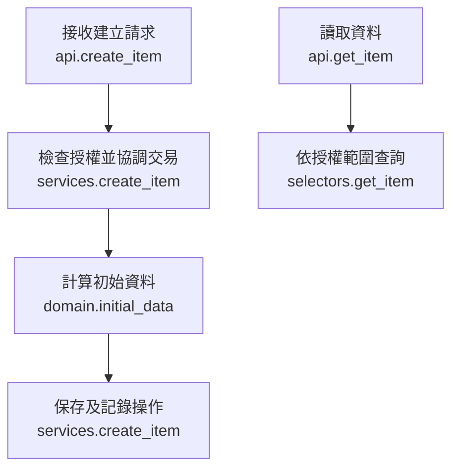

# PR 結構與檢核範本

撰寫時讀取本檔。這是內容順序與品質示例；用實際變更取代示例，依專案 PR template 合併章節。各段長度隨改動規模調整。

## 做了什麼（模組目的）

說明誰在什麼條件下，現在能完成什麼行為，以及為何需要這個變更。

**審核重點：** 列出少量決定是否可接受本份交付的判斷。

分批交付時：標示本份序號／目的、前置 PR 與下一批，並說明影響判斷的未交付依賴。

### 建議閱讀順序

1. 主要入口／服務連結：可核對的行為。
2. 查詢／規則連結：可核對的授權或業務判斷。
3. 測試連結：可核對的成功與拒絕證據。

如有生成檔，說明用途及可延後閱讀的部分。

## 模組工作流程圖

以下為示意名稱；交付時用實際函式及呼叫關係取代。

## 怎麼測試

列出本份版本、執行命令、結果及必要限制。只列適用檢查；把未執行標為待驗證。CI 可連到該 commit 的 run。

### 人工檢查檢核表

前提：指定測試環境、角色／場站、合成資料與操作入口。完整操作範例可連至模組文件。

- [ ] 成功：以有權限角色執行主要操作，確認回應與重新讀取的結果。
- [ ] 拒絕：使用不合法輸入或不符狀態，確認錯誤與應保持的資料。
- [ ] 隔離：若涉及權限／範圍，分別以允許與拒絕角色核對可見結果。

記錄分支 SHA、角色、輸入、預期／實際結果與證據連結。按本份行為調整上述項目。

自動測試對照與必要限制

| 業務行為 | 測試函式／證據連結 | 結果 |
|---|---|---|
| 本份需證明的規則 | 實際測試或 run | 通過／失敗／待驗證 |

只保留影響檢查範圍、可信度或重現的限制。

## 與其他模組的關聯

| 模組／責任方 | 提供的介面、本份如何使用或後續交接 |
|---|---|
| 真實依賴 | 實際責任與交付狀態 |

## 檢查清單

沿用專案 PR template。將檢查結果、人工驗收、獨立 reviewer approval 分開列項，只勾選已有證據的項目。
