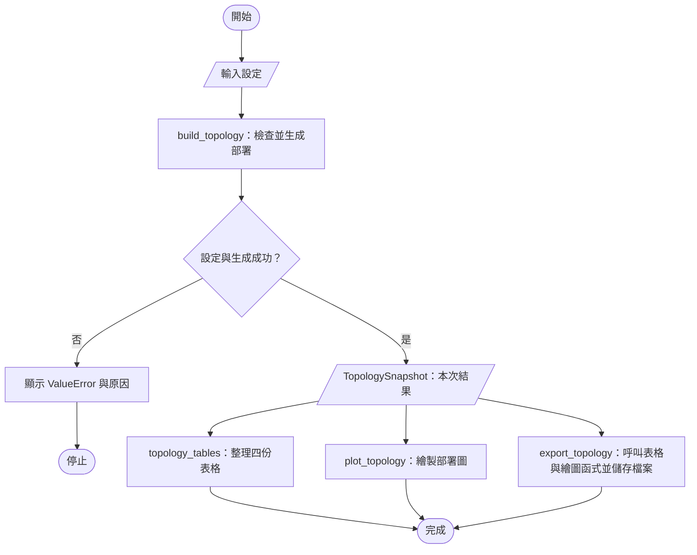

# 新增靜態 IAB 拓撲與專案說明資料

對應Issue：https://github.com/tonywang07009/PY_NetworkSimulator/issues/1。交付分支為 `feat/iab-topology`，base為`main`。本PR先作草稿交付，保留未完成的歸檔／合併事項；尚無遠端CI結果。

## 做了什麼

研究者可以用 Notebook 設定 1 個 Donor、5 個 Node 與 Tag 分布，產生位置固定的部署圖、四份表格及資料檔。Tag 的區域數量保持設定值，每個 Tag 只屬於一個 Node，各 Node 至少分到設定的最低數量。

- 正式程式集中在 `src/iab/`，對應檢查位於 `tests/iab/`。
- 所有共用 dataclass 與必要 Enum 保留於單一 `contracts.py`。
- Notebook 使用相同模組，提供列點說明、設定範例、表格、結果檢查及圖片。
- 中英文使用說明分成總覽、設定、操作、結果與常見問題。
- 依使用者「目前內容都push」授權，同時保存現有ReferDoc、AgentDoc、專案工作流工具與訪談資料；參考PDF及既有教材不是本次新實作，審核可先聚焦src/iab、Notebook與使用說明。
- 主規格已同步；SNR、BER、電量、排程與 UE 實體位置尚未實作。

**審核重點：** Tag 數量及唯一歸屬、10／30／50 m 邊界、設定拒絕、表格與圖片是否使用同一份結果。

### 建議閱讀順序

1. `ReferDoc/Implementation/IABTopology/README.md`：先了解用途與操作入口。
2. `notebooks/01_iab_topology.ipynb`：查看預設設定、表格與部署圖。
3. `src/iab/contracts.py`、`src/iab/topology.py`：核對設定、生成與拒絕規則。
4. `src/iab/plotting.py`：核對實際位置與分區顯示。
5. `tests/iab/` 與主規格 `AgentDoc/openspec/specs/iab-topology/spec.md`：核對情境與要求。

圖片與 Notebook 輸出是生成結果；先讀操作與規則，再查看完整輸出。

## 工作流程

匯出失敗會向呼叫端回報錯誤，可能留下部分檔案；不是整個匯出成功後才一次寫入。

## 怎麼檢查

- 程式情境：`MPLBACKEND=Agg python -m pytest tests/iab -q`。
- Notebook：以已有 Notebook 套件的 Python 執行 `tests/iab/execute_topology_notebook.py`。
- 規格：`OPENSPEC_TELEMETRY=0 openspec validate iab-topology --type spec --strict`。

已保存的自動檢查結果及限制

- 目錄搬移後已執行 142 項：69 個案例各由 Notebook／模組兩入口執行，加 4 個抽離前後基準比對；兩入口共用實作。
- 乾淨 kernel 執行 11 個程式區塊，零錯誤，執行後關閉。
- 自動檢查環境為 Python 3.12；Notebook 為既有 RL Python 3.11.15。完整版本與命令保留在本機驗證紀錄。
- 本輪只補 Notebook Markdown、拆分說明與同步規格，沒有改動已通過檢查的程式碼；沒有為文字變動重跑完整情境。
- 這些是代理執行的檢查，不能替代使用者實際操作、獨立 reviewer approval、遠端 CI 或合併證據。

### 人工檢查

前提：在專案根目錄，以具備 Matplotlib、IPython 的 Python 環境開啟 Notebook。

- [x] 主要程式邏輯已由使用者導讀理解並授權抽離。
- [x] 使用者已接受產品使用說明風格與 Notebook 列點說明。
- [ ] 由使用者實際執行預設範例，確認 5 UE、30 Tags、三區 10／13／7。
- [ ] 由使用者修改 seed，對照不同 Tag 分配與固定站點位置。
- [ ] 由使用者輸入不足的 Tag 總數，確認錯誤訊息與處理方式清楚。

## 與其他模組的關係

| 檔案／功能 | 責任 |
|---|---|
| `contracts.py` | 共用設定與資料格式 |
| `topology.py` | 生成結果、整理表格及協調匯出 |
| `plotting.py` | 由同一份結果繪圖 |
| Notebook | 設定、操作及閱讀結果 |
| 後續通道／能量／排程 | 目前尚未實作，不包含在本份交付 |

## 交付狀態

- [x] 本機實作、情境檢查、程式審查及人工邏輯導讀。
- [x] 主規格、分章使用說明與 README 整理。
- [x] 建立並對應本 change 的 Issue #1。
- [ ] 完成歸檔條件核對及實際移動，更新連結與證據路徑。
- [ ] 經授權後 commit、push 並發布 PR。
- [ ] 由使用者合併，核對實際 merge 與 Issue 結果。

### 歸檔待辦

現行archive skill會在任何未完成task存在時停止，但本change的task包含PR合併後才能核對的4.3，造成順序衝突。本PR先保留active change與archive-preparation.md，不冒稱已歸檔。此衝突需在後續workflow討論中釐清，完成合併前仍維持此change活動中，不開始下一個模組實作。

## 已發布位置

- Issue：https://github.com/tonywang07009/PY_NetworkSimulator/issues/1
- 草稿PR：https://github.com/tonywang07009/PY_NetworkSimulator/pull/2
- 目前內容已push至feat/iab-topology；未合併、未實際歸檔。
