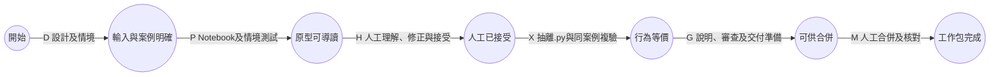

# AOA、關鍵路徑與進度控制

## 主網路與實際排程分開讀

- [AOA 主網路](aoa-network.md)：15 條實工作包箭線與 7 條 0 h 虛活動；節點為事件，不把模組寫在節點冒充 AOA。
- 每個工作包的箭線可展開成 D→P→H→X→G→M，詳見 [aoa-detail.csv](aoa-detail.csv)。彙總及展開網路的期望關鍵路徑皆為 **203.75 有效小時**。
- 主網路僅保留必要的直接相依；W05 經 W04／W02／W01 已依賴通道，不再多畫重複箭線。
- W03／W04／W06 可以在功能相依上分流；W07 必須等待三支路都完成。W11／W12 同理，W13 必須等待兩者。
- 在目前一位驗收者、單一 change 在製的交付規則下，**實際建議次序仍為 W01→W02→…→W15**。這些是資源及治理排序，不是額外的物理模組依賴。
- [資源排程圖](resource-gantt.svg) 因此是約 93 個工作日；不能將 203.75 h 直接除以 4 宣稱可以約 51 日完成。

AOA 事件／虛活動表示法參考 [EIT 工程專案管理教材 §2.2](https://www.eit.edu.au/resources/practical-project-management-for-engineers-and-technicians/)；資源限制另行重排的原則參考 [PMI 排程與資源平衡](https://www.pmi.org/learning/library/2019/04/07/15/39/scheduling-resource-leveling-project-progression-8006)。本專案的事件編號及相依是本次設計。

## CPM 計算口徑

對活動 `(i,j)`、期望工時 `d_ij`：

```text
E(start) = 0
E(j) = max_i [E(i) + d_ij]          # 正推
L(finish) = E(finish)
L(i) = min_j [L(j) - d_ij]          # 逆推

ES = E(i)        EF = E(i) + d_ij
LF = L(j)        LS = L(j) - d_ij
TF = L(j) - E(i) - d_ij
FF = E(j) - E(i) - d_ij
```

- `E/L`：事件最早／最晚時點；`ES/EF/LS/LF`：活動最早／最晚起訖。
- `TF` 是總浮時，`FF` 是自由浮時；此處是無資源限制的工時，不是實際日曆上的可休假日數。
- 完整數值見 [cpm.csv](cpm.csv)；中間事件及虛活動保留原有精確相依。

### 期望工時的關鍵路徑

```text
W01 → W02 → W04 → W05 → D02 → W07 → W08 → W09 → W10
    → W12 → D05 → W13 → D07 → W15
總長 203.75 h；D02／D05 為0 h虛活動。
```

| 非關鍵工作包 | 無資源限制總浮時 TF | 應如何解讀 |
|---|---:|---|
| W03 時間表 | 22.25 h | 在理想平行網路下可稍晚完成；不是可以跳過 |
| W06 服務 | 18.25 h | 同上；實際仍受共用工程／導讀容量限制 |
| W11 Baseline | 5.00 h | 同時是 W14 接入前置，應一起監控 |
| W14 CLM 接入 | 9.00 h | 由 W11 分支，與 W13 分支匯合後進 W15；服務不穩定會消耗浮時 |

彙總工作包的 FF 可能為 0，而後接虛活動帶有等待餘裕；這是所選 AOA 事件表示的結果，不代表 TF 消失。實際單一 change 排程沒有可同時挪用的模組浮時，延遲任一包都可能推遲後續交付。

## 每個工作包的內部活動



- D 先確認必要參數、資料權限及預期值；沒有答案就保留未決，不能用排程到期替代決策。
- P 採情境先行，乾淨 kernel 從頭執行；核對需求、呼叫端及測試，解決範圍內缺陷。
- H 前備齊架構圖及 tree 式 code-trace；審查與相應修正先做，再逐段帶您理解。H 完成條件是您明確接受。
- X 只搬移已接受核心，同情境對照；有行為改動就回到受影響的接受關卡。
- G 更新簡明產品說明及 Notebook 列點、審查、規格與同份交付準備。Agent 紀錄留本機 worktree。
- M 需當次發布授權及實際合併證據；現有工作流預設由您合併。授權、測試通過或建立 PR 都不等於合併完成。
- 若某包只有整合／校準而無新核心，X 用於重用已接受 `.py`、核對等價及設定封裝，無須刻意新增類別。

## 進度與修正方式

1. 每日只記當日實際活動與工時，不以已產生程式行數估計完成率。
2. 每包用 0／100 記「交付完成」，另以 D/P/H/X/G/M 標示進行位置；原型通過不記為整包完成。
3. 保存原計畫、實際工時、剩餘工時與原因，先更新剩餘估算，再重算整張網路及資源排程。
4. W01／W02 完成後校正 P 及 H 的工時；這是第一次可用的本專案分階段實績，不把初估當模型真值。
5. 建議當工作包剩餘估算使總工時增加超過 25%，或外部阻塞超過 2 個工作日時，一起檢視範圍／順序。此為提議的重估觸發點，不是自動降品質規則。
6. 不為趕工略過人工接受、情境或等價複驗。可優先縮小研究實驗矩陣、延後 M2／M3，讓 M1 先交付；需您明確選擇後才改基準。

不建議尚無實績就做成本斜率趕工分析：目前缺正常／趕工成本與可壓縮工時。

年底加速版另納入 W11／W14 近關鍵支路，詳見 [05 年底加速](05-year-end-acceleration.md)；原容量的浮時不直接當作年底的允許延誤。
