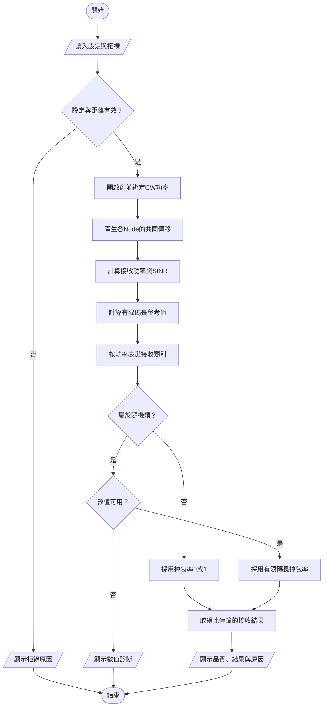

# 通道模型：閱讀與操作指南

- 本版已完成 Notebook 導讀與人工接受。
- 核心程式位於 `src/channel/`。
- 開啟 [02_channel_model.ipynb](../../../notebooks/02_channel_model.ipynb)。
- 從第一個 cell 依序執行。
- 每段程式前都有對應的來源。
- Notebook 匯入核心 `.py`，保留說明與示範。

## 能做什麼

- 讀取既有的 IAB 拓樸快照。
- 計算 Node 與 Tag 間的接收功率。
- 顯示 SNR 與 SINR。
- 用有限碼長近似估計短封包掉包率。
- 按研究功率表決定接收類別。
- 保持同窗品質，改變新窗品質。
- 重現每次封包接收的結果。

SNR 是訊號與噪聲的功率比。
SINR 的分母另含外部干擾。
有限碼長近似考慮封包只有有限個符號。


## 程式放在哪裡

```text
src/channel/
├── __init__.py       # 套件標記
├── contracts.py      # Config、DTO與列舉
└── channel_model.py  # 通道計算、分窗與封包接收
```

- [contracts.py](../../../src/channel/contracts.py) 集中資料格式。
- [channel_model.py](../../../src/channel/channel_model.py) 提供計算與狀態管理。
- `tests/channel/` 保留對應的情境測試。
- Notebook 與其他呼叫端使用同一份核心。
- 您在 Notebook 補充的核心註解已移入 `.py`。

在專案根目錄，可用下列方式呼叫：

```bash
PYTHONPATH=src python - <<'PYTHON'
from channel.contracts import ChannelConfig, PowerLevel
from channel.channel_model import ChannelModel
from iab.topology import build_topology, example_config

model = ChannelModel(ChannelConfig(), build_topology(example_config()))
model.window(0, PowerLevel.LOW)
print(model.link(0, 'Tag-001'))
PYTHON
```

## 建議閱讀順序

|Notebook 節次|要理解的問題|
|---|---|
|1–2|程式使用哪些設定與單位？|
|3|距離如何影響接收品質？|
|4|資料量與碼長如何影響掉包率？|
|5|哪些接收結果由研究假設決定？|
|6–7|亂數、窗與傳輸身分如何配合？|
|8–13|實際結果是否符合上述說明？|
|14|回顧已接受的模型與使用限制。|

## 如何辨識來源

|來源層級|例子|閱讀方式|
|---|---|---|
|文獻公式|往返路損、二元輸入有限碼長近似|核對章節、式號及使用條件。|
|研究假設|HIGH 三區可靠、同窗品質固定|核對已接受的研究決策。|
|測試設定|915 MHz、CW -2／10／22 dBm|核對 entry pack；不當成戶外量測。|
|工具文件|dataclass、求積、對數機率|理解程式用法。|

## 可以先核對的例子

|設定|結果|
|---|---|
|LOW、中區20m、偏移0dB|接收功率約 −127.394 dBm。|
|同上，k64／n128|SINR 約 −2.404 dB；掉包率約0.327073。|
|HIGH，任一區|採用掉包率0；原因是研究功率表。|
|距離0.999m|拒絕計算，不移動Tag。|

原始近似值與採用值分開顯示。
`None` 表示無法提供原始數值。
它不代表掉包率為0。

## 執行環境

- Python 需有 NumPy、SciPy 及 Jupyter。
- 執行位置為專案根目錄或 `notebooks/`。
- 使用現有的 RL 環境即可。
- 不需註冊新的使用者 kernel。
- 不需更動既有 IAB 程式。

可用獨立 kernel 重跑並保存結果：

```bash
/home/tonywang/miniforge3/envs/RL/bin/python tests/channel/execute_channel_notebook.py /tmp/pynet-channel-execution.json
```

執行行為測試：

```bash
python -m pytest tests/channel -q
```

## 操作流程

下圖使用標準符號，由上往下閱讀。
本版沒有另編虛擬碼，因此不標虛擬行號。



## 使用範圍

- 本版假設封包已具備傳送條件。
- 尚未整合能量、接入或完整時間軸。
- k/n 尚未映射成正式標準 TBS。
- 理論近似不等於實際編碼器性能。
- 對數機率保留浮點尾端資訊。
- 有限亂數仍無法解析任意小的機率。
- 本版不提供戶外場域品質保證。

## 相關資料

- [已接受的測試配置](../../../Plan/channel-entry-pack.md)
- [功率與鏈路綁定](../../../Plan/channel-link-binding.md)
- [公式與文獻依據](../../../Plan/channel-formula-evidence.md)
- [研究決策 §33](../../Plan/R-01_System_Model_and_Baseline_Decision_Record.md)
- [概念流程圖](../../../docs/architecture/channel-model.html)
