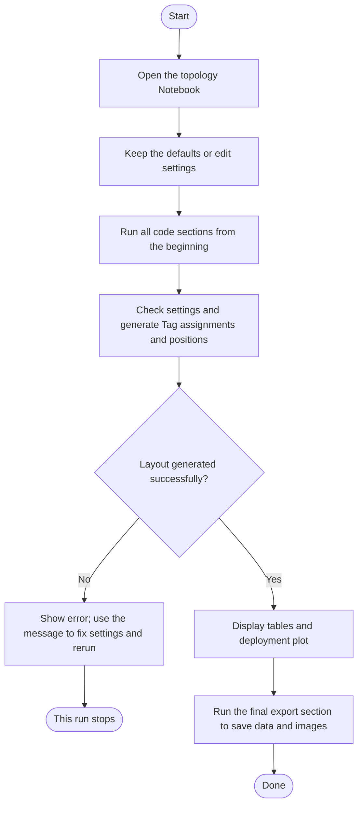

# Getting started

[Back to the user guide](README.en.md)

## What do I need before starting?

Use [01_iab_topology.ipynb](../../../notebooks/01_iab_topology.ipynb). This Notebook document lets you run Python code in sections and view tables and images alongside it.

Open the file with a tool that supports `.ipynb`, such as Jupyter or VS Code. Select a Python environment with the Matplotlib plotting package available. Settings are currently edited in the Notebook code; there is no settings form.

For your first run, keep the default settings and run all code sections from the beginning. You should see the settings, Node, Tag and connection tables, followed by the deployment plot.

## How do I create and save a deployment map?

Follow the flow below. Rounded boxes mark the start or end, rectangles show actions, and the diamond shows a decision.



For example, to keep 30 Tags and the existing position settings while trying another random layout, replace the code in the Notebook's section headed “可直接修改的設定與生成結果” with:

```python
config = example_config(seed=7)
snapshot = build_topology(config)
tables = topology_tables(snapshot)
```

Here, `config` holds the settings, `snapshot` holds the generated layout, and `tables` holds tables prepared from that layout. Leave the other code sections unchanged and run all sections from the beginning to update the results.

The final export section saves files under [notebooks/artifacts/iab-topology/](../../../notebooks/artifacts/iab-topology/). Running it again overwrites files with the same names. Copy results to another folder first if you want to keep several layouts.
