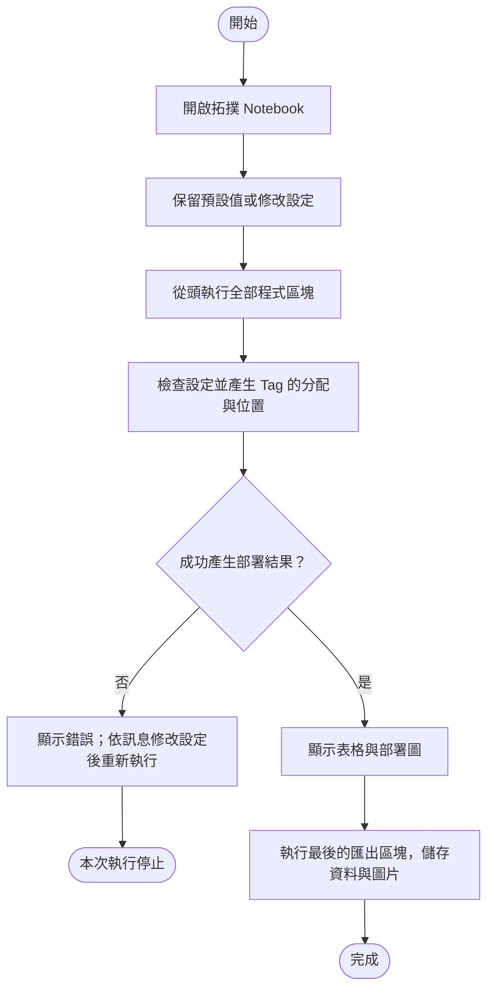

# 操作步驟

[回到使用說明](README.md)

## 開始前需要準備什麼？

使用專案內的 [01_iab_topology.ipynb](../../../notebooks/01_iab_topology.ipynb) 操作。這是一份可以分段執行 Python 程式、同時查看表格與圖片的 Notebook 文件。

請用可以開啟 `.ipynb` 的工具，例如 Jupyter 或 VS Code，並選擇已具備 Matplotlib 繪圖套件的 Python 環境。本專案目前的操作方式是修改 Notebook 中的設定程式，尚未提供表單式設定畫面。

第一次使用時，可以先保留所有預設值，從頭執行全部程式區塊，確認能看到設定表、Node 表、Tag 表、連線表及部署圖。

## 如何產生與儲存部署圖？

操作流程如下。圓角框表示開始或結束，矩形表示操作步驟，菱形表示條件判斷。



例如，想保留 30 個 Tag 與原本的位置設定，只換一組隨機配置，可以在 Notebook 的「可直接修改的設定與生成結果」區塊改為：

```python
config = example_config(seed=7)
snapshot = build_topology(config)
tables = topology_tables(snapshot)
```

這裡的 `config` 是本次設定，`snapshot` 是產生的部署結果，`tables` 是由該結果整理出的表格。其他程式區塊維持原樣，再從頭執行全部區塊即可更新結果。

執行最後的匯出區塊後，檔案會放在 [notebooks/artifacts/iab-topology/](../../../notebooks/artifacts/iab-topology/)。再次執行會覆寫該資料夾內的同名檔案；若想保留不同設定的結果，請先複製到其他資料夾。
