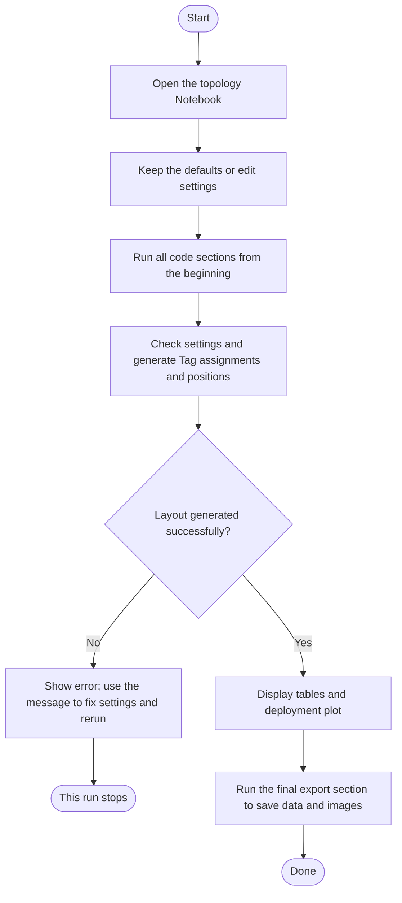

# IAB Network Topology User Guide

English draft for content review. [繁體中文版](draft.zh-TW.md)

## 1. What does this feature do?

This feature creates a static network deployment map. It lets you inspect each Node's position, the Tags assigned to it, and their distances from that Node. You can view the results as tables and save both images and data files.

The current layout contains:

| Name | Role in this scenario | Number |
|---|---|---:|
| Donor | The upstream station connected to all IAB Nodes | 1 |
| IAB Node, called Node below | Connects to the Donor and reads its assigned Tags | 5 |
| UE | User equipment associated with a Node | 1 per Node |
| Tag | A label device randomly assigned and placed around a Node | Configurable; 30 in the default example |

Each Tag belongs to exactly one Node. A Node can have several Tags. Positions remain fixed during a simulation.

## 2. What do I need before starting?

Use [01_iab_topology.ipynb](../../../notebooks/01_iab_topology.ipynb). This Notebook document lets you run Python code in sections and view tables and images alongside it.

Open the file with a tool that supports `.ipynb`, such as Jupyter or VS Code. Select a Python environment with the Matplotlib plotting package available. Settings are currently edited in the Notebook code; there is no settings form.

For your first run, keep the default settings and run all code sections from the beginning. You should see the settings, Node, Tag and connection tables, followed by the deployment plot.

## 3. Which settings can I change?

| Setting | Default | Meaning |
|---|---|---|
| Donor and Node positions | Specified in the example | x and y coordinates on a flat map, in metres |
| Outer radius of each zone | `(10, 30, 50)` m | Draws near, middle and far zones around each Node |
| Tag count in each zone | `(10, 13, 7)` | 10 near, 13 middle and 7 far Tags across the entire scene: 30 in total |
| Minimum Tags per Node | `2` | Each Node receives at least two Tags; the remainder are assigned randomly |
| Random seed `seed` | `42` | A number controlling the random result; the same settings and number reproduce the layout within the same program and environment |

Zone distances are measured from each Tag's assigned Node:

| Zone | Distance |
|---|---|
| Near | More than 0 m and no more than 10 m |
| Middle | More than 10 m and no more than 30 m |
| Far | More than 30 m and no more than 50 m |

For example, a Tag at 10 m belongs to the near zone, while a Tag at 20 m belongs to the middle zone. Counts apply to the entire scene; each Node does not receive its own set of 10/13/7 Tags.

In the settings code, use parentheses `(...)` for radii, counts and the Node list, rather than square brackets `[...]`. A zone can have zero Tags, as in `(10, 0, 0)`, provided the total is sufficient to meet every Node's minimum.

## 4. How do I create and save a deployment map?

Follow the flow below. Rounded boxes mark the start or end, rectangles show actions, and the diamond shows a decision.



For example, to keep 30 Tags and the existing position settings while trying another random layout, replace the code in the Notebook's section headed “可直接修改的設定與生成結果” with:

```python
config = example_config(seed=7)
snapshot = build_topology(config)
tables = topology_tables(snapshot)
```

Here, `config` holds the settings, `snapshot` holds the generated layout, and `tables` holds tables prepared from that layout. Leave the other code sections unchanged and run all sections from the beginning to update the results.

The final export section saves files under [notebooks/artifacts/iab-topology/](../../../notebooks/artifacts/iab-topology/). Running it again overwrites files with the same names. Copy results to another folder first if you want to keep several layouts.

## 5. How do I read the results?

### Tables

| Table | What it shows |
|---|---|
| Settings: `settings` | Positions, radii, Tag counts and random seed used for this run |
| Nodes: `nodes` | Each Node's position, UE and near/middle/far Tag counts |
| Tags: `tags` | Each Tag's ID, position, assigned Node, distance and zone |
| Connections: `links` | Donor-to-Node connections and each Node's associated UEs and Tags |

The default example should contain five Nodes, five UEs and 30 Tags, with near/middle/far counts of 10/13/7. Every Node has at least two Tags, but Node totals do not have to be equal.

### Deployment plot

| Mark | Meaning |
|---|---|
| Star | Donor position |
| Square | Node position |
| Teal, orange-brown and purple circles and Tag dots | Near, middle and far zones, respectively |
| Number beside a dot | Tag ID; for example, `001` means `Tag-001` |
| Line between the Donor and a Node | Their connection |

Both axes use metres at the same scale. UEs have an assigned Node but no physical position in the current model, so they are not plotted.

### Saved files

| File | Purpose |
|---|---|
| `deployment.png`, `deployment.svg` | Deployment images for viewing or inclusion in a report |
| `settings.csv`, `nodes.csv`, `tags.csv`, `links.csv` | Four tables that can be opened in a spreadsheet tool |
| `snapshot.json` | A data file containing the full settings and generated layout |

## 6. Common problems and solutions

If settings break a rule, the program shows `ValueError` and a reason. Read that message first, then use the table below.

| Problem | Cause and action |
|---|---|
| Too few Tags | Five Nodes with a minimum of two each require at least 10 Tags; raising the minimum also raises the required total |
| Node circles overlap or touch | With the default 50 m outer radius, every pair of Node centres must be more than 100 m apart; adjust their positions |
| Invalid radii | Use three positive radii in increasing order, such as `(10, 30, 50)` |
| Settings use square brackets | Use parentheses instead; for example, change `[10, 13, 7]` to `(10, 13, 7)` |
| Repeated Node or Donor ID | Use distinct names and avoid IDs reserved for generated UEs and Tags |
| Teaching checks stop after changing Tag counts | The supplied checks expect 30 Tags with counts of 10/13/7; update their expected counts too, or run the sections individually up to the table display to inspect your new layout |
| Images or data cannot be saved | Check that the output folder is writable; a failed export may leave some files, so rerun export after fixing the issue |

To try a different random layout, change `seed` and run again. The specified Donor and Node positions stay fixed; Tag assignments and positions are generated again.

## 7. Scope and further reading

This feature currently describes positions and connections. It does not yet calculate signal quality, transmission success, battery levels or scheduling. Colours indicate distance zones rather than signal quality. Separate deployment circles do not establish that wireless interference is absent.

Integrating Tag reading into a Node is part of this research model. Its use within the IAB split base-station architecture is a research extension, not a claim of full standards compliance.

For the reasons behind the settings, read the [system model plan](../../Plan/R-01_System_Model_and_Baseline_Decision_Record.md). For implementation details, see the [IAB source files](../../../src/iab/).
