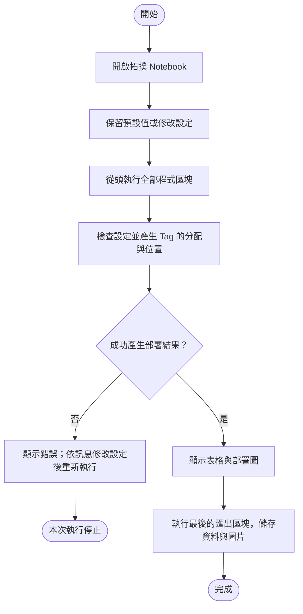

# IAB 網路拓撲使用說明

中文草稿，供內容檢閱。[English version](draft.en.md)

## 1. 這個功能可以做什麼？

這個功能用來建立一張靜態的網路部署圖，讓您查看每個節點的位置、底下有哪些 Tag，以及 Tag 與節點之間的距離。建立完成後，可以查看表格，也可以儲存圖片與資料檔案。

目前的配置為：

| 名稱 | 在這個場景中的用途 | 數量 |
|---|---|---:|
| Donor | 連接所有 IAB Node 的上層節點 | 1 |
| IAB Node，以下簡稱 Node | 連接 Donor，並負責讀取自己底下的 Tag | 5 |
| UE | 與 Node 關聯的使用者設備 | 每個 Node 1 個 |
| Tag | 隨機分配到 Node 周圍的標籤裝置 | 可設定；預設共 30 個 |

每個 Tag 只屬於一個 Node。同一個 Node 可以連接多個 Tag。這張圖中的位置在一次模擬中保持固定。

## 2. 開始前需要準備什麼？

使用專案內的 [01_iab_topology.ipynb](../../../notebooks/01_iab_topology.ipynb) 操作。這是一份可以分段執行 Python 程式、同時查看表格與圖片的 Notebook 文件。

請用可以開啟 `.ipynb` 的工具，例如 Jupyter 或 VS Code，並選擇已具備 Matplotlib 繪圖套件的 Python 環境。本專案目前的操作方式是修改 Notebook 中的設定程式，尚未提供表單式設定畫面。

第一次使用時，可以先保留所有預設值，從頭執行全部程式區塊，確認能看到設定表、Node 表、Tag 表、連線表及部署圖。

## 3. 可以調整哪些設定？

| 設定 | 預設值 | 如何理解 |
|---|---|---|
| Donor 與 Node 位置 | 範例中已指定 | 平面上的 x、y 座標，單位為公尺 |
| 三個區域的外側半徑 | `(10, 30, 50)` m | 以每個 Node 為圓心，畫出近、中、遠三區 |
| 三個區域的 Tag 數量 | `(10, 13, 7)` | 全場近區 10 個、中區 13 個、遠區 7 個，共 30 個 |
| 每個 Node 最少 Tag 數量 | `2` | 每個 Node 至少分到 2 個 Tag，其餘隨機分配 |
| 隨機種子 `seed` | `42` | 控制隨機結果的編號；同一程式與環境中，保留設定與編號可重現相同配置 |

三區的距離都是從 Tag 所屬的 Node 開始量：

| 區域 | 距離範圍 |
|---|---|
| 近區 | 大於 0 m，且不超過 10 m |
| 中區 | 大於 10 m，且不超過 30 m |
| 遠區 | 大於 30 m，且不超過 50 m |

例如，距離 10 m 的 Tag 屬於近區；距離 20 m 的 Tag 屬於中區。三區數量是全場總數，不是要求每個 Node 都各有 10／13／7 個 Tag。

在設定程式中，半徑、數量和 Node 清單都使用小括號 `(...)`，不要改成中括號 `[...]`。三區數量可以有 0，例如 `(10, 0, 0)`，但總數仍須足夠讓每個 Node 達到最低數量。

## 4. 如何產生與儲存部署圖？

操作流程如下。圓角框表示開始或結束，矩形表示操作步驟，菱形表示條件判斷。



例如，想保留 30 個 Tag 與原本的位置設定，只換一組隨機配置，可以在 Notebook 的「可直接修改的設定與生成結果」區塊改為：

```python
config = example_config(seed=7)
snapshot = build_topology(config)
tables = topology_tables(snapshot)
```

這裡的 `config` 是本次設定，`snapshot` 是產生的部署結果，`tables` 是由該結果整理出的表格。其他程式區塊維持原樣，再從頭執行全部區塊即可更新結果。

執行最後的匯出區塊後，檔案會放在 [notebooks/artifacts/iab-topology/](../../../notebooks/artifacts/iab-topology/)。再次執行會覆寫該資料夾內的同名檔案；若想保留不同設定的結果，請先複製到其他資料夾。

## 5. 如何閱讀結果？

### 表格

| 表格 | 可以查到什麼？ |
|---|---|
| 設定表 `settings` | 本次使用的位置、半徑、Tag 數量與隨機種子 |
| Node 表 `nodes` | 每個 Node 的位置、UE，以及近／中／遠區 Tag 數量 |
| Tag 表 `tags` | 每個 Tag 的編號、位置、所屬 Node、距離與區域 |
| 連線表 `links` | Donor 連到哪些 Node，以及各 Node 連到哪些 UE、Tag |

預設範例應有 5 個 Node、5 個 UE、30 個 Tag；近／中／遠區分別為 10／13／7 個。每個 Node 至少有 2 個 Tag，但各 Node 的總數不必相同。

### 部署圖

| 圖上標記 | 意義 |
|---|---|
| 星形 | Donor 的位置 |
| 方形 | Node 的位置 |
| 藍綠、橘褐、紫色圓框與 Tag 圓點 | 分別表示近區、中區、遠區 |
| 圓點旁的數字 | Tag 編號，例如 `001` 代表 `Tag-001` |
| Donor 與 Node 之間的線 | 兩者的連接關係 |

圖上的 x、y 軸都以公尺表示，兩軸比例相同。UE 目前只記錄所屬 Node，沒有設定實際位置，因此不畫在圖上。

### 儲存的檔案

| 檔案 | 用途 |
|---|---|
| `deployment.png`、`deployment.svg` | 查看或放入報告的部署圖 |
| `settings.csv`、`nodes.csv`、`tags.csv`、`links.csv` | 可用試算表工具開啟的四份表格 |
| `snapshot.json` | 保存本次完整設定與部署結果的資料檔 |

## 6. 常見問題與處理方式

設定不符合規則時，程式會顯示 `ValueError` 與原因。請先查看訊息，再依下表調整。

| 情況 | 原因與處理方式 |
|---|---|
| Tag 數量不足 | 5 個 Node、每個至少 2 個，因此總數至少 10 個；增加最低數量時也要增加總數 |
| Node 的圓域重疊或相切 | 預設外圈半徑是 50 m，任兩 Node 圓心距離必須大於 100 m；調整 Node 位置 |
| 半徑設定錯誤 | 三個半徑必須為正數，且由小到大排列，例如 `(10, 30, 50)` |
| 設定使用中括號 | 改用小括號，例如將 `[10, 13, 7]` 改成 `(10, 13, 7)` |
| Node 或 Donor 編號重複 | 改成不同名稱，並避開系統產生的 UE、Tag 編號 |
| 修改 Tag 數量後，教學檢查區塊停止 | Notebook 的示範檢查以預設 30 個、三區 10／13／7 個為準；改數量時，需要同步修改該區塊的預期數量，或先逐段執行到表格顯示處查看結果 |
| 圖片或資料無法儲存 | 確認輸出資料夾可以寫入；中途失敗可能只留下部分檔案，處理後重新匯出 |

若只想換一組隨機分配，修改 `seed` 後重新執行即可。Donor 與 Node 的指定位置保持不變，Tag 的分配與位置會重新產生。

## 7. 使用範圍與延伸閱讀

本功能目前描述的是部署位置與連接關係，尚未計算訊號品質、傳輸成功率、電量或排程。顏色代表距離區域，不能直接當成訊號品質；圓域不重疊，也不能用來判定沒有無線干擾。

Node 整合 Tag 讀取功能是本研究採用的設定；它在 IAB 分離式基地台架構下的整合屬研究擴充，不代表已符合完整標準。

需要了解設定依據時，可讀 [系統模型規劃](../../Plan/R-01_System_Model_and_Baseline_Decision_Record.md)。需要查看程式時，再讀 [程式導讀](../../../docs/architecture/code-trace.md)。
