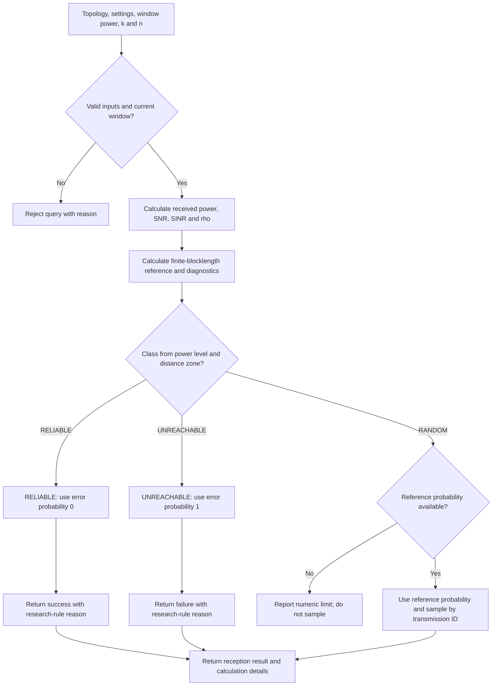

[English](channel-model.en.md) | [繁體中文](channel-model.zh-TW.md)

# Channel model unit

This unit explains channel formulas and research reception rules. Complete the [quick start](../../README.md#quick-start) first.

## How formulas and research rules determine reception

The formulas calculate link quality and a finite-blocklength (FBL) reference error probability.
FBL uses link quality, information bits `k`, and transmitted symbols `n` to estimate packet error probability.
The research power table then selects which probability the model uses.
The table does not change the calculated SNR or SINR.

The diagram shows a packet query through `ChannelModel.receive()`.
A `ChannelModel.link()` query returns the link calculation and selected probability without sampling a packet.

For a narrow screen, [open the SVG diagram](assets/reception.en.svg) and zoom in.

The research table selects these classes:

| Power level | Near | Middle | Far |
|---|---|---|---|
| LOW | RELIABLE | RANDOM | UNREACHABLE |
| MEDIUM | RELIABLE | RELIABLE | RANDOM |
| HIGH | RELIABLE | RELIABLE | RELIABLE |

`RELIABLE` gives success with error probability 0; `UNREACHABLE` gives failure with error probability 1.
Research rules determine these outcomes, even when the FBL reference differs.
`RANDOM` uses the FBL probability to sample a packet result.
If that probability is unavailable, the packet query raises an error instead of sampling.
A floating-point tail value of 0 or 1 does not change `RANDOM` to another class; sampling uses the logarithmic probabilities.

For example, a middle-zone Tag under LOW uses the FBL probability.
Under MEDIUM, the same zone uses error probability 0 because the table selects `RELIABLE`.
That zero does not mean the formula proves error-free reception.
The model keeps the FBL reference, selected probability, class, and reason so the reader can distinguish them.
Packet results also include sampling details; repeated queries with the same identity and parameters return the same result.

See the [channel implementation](../../src/channel/channel_model.py) and [channel guide](../../ReferDoc/Implementation/ChannelModel/README.md) for formulas and numerical limits.

Return to [architecture and data flow](../architecture.en.md).
