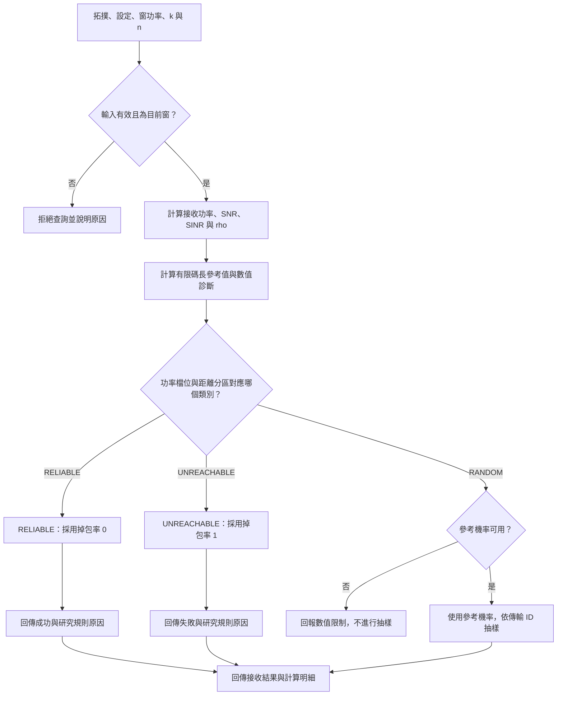

[English](channel-model.en.md) | [繁體中文](channel-model.zh-TW.md)

# 通道模型單元

本單元說明通道公式與研究接收規則。請先完成[快速開始](../../README.zh-TW.md#快速開始)。

## 通道公式與研究規則如何決定接收結果

通道公式先計算鏈路品質，以及有限碼長（finite blocklength，FBL）的參考掉包率。
FBL 根據鏈路品質、資訊位元數 `k` 與傳輸符號數 `n`，估計封包錯誤機率。
研究功率表再決定模型實際採用哪個機率；表格不會改寫已算出的 SNR 或 SINR。

下圖呈現 `ChannelModel.receive()` 查詢一次封包接收的流程。
若只呼叫 `ChannelModel.link()`，則回傳鏈路計算與採用機率，不進行封包抽樣。

研究功率表採用以下接收類別：

| 功率檔位 | 近區 | 中區 | 遠區 |
|---|---|---|---|
| LOW | RELIABLE | RANDOM | UNREACHABLE |
| MEDIUM | RELIABLE | RELIABLE | RANDOM |
| HIGH | RELIABLE | RELIABLE | RELIABLE |

`RELIABLE` 表示掉包率採用 0，接收結果為成功；`UNREACHABLE` 表示掉包率採用 1，結果為失敗。
這些結果來自研究規則，即使 FBL 參考值不同，仍按表格處理。
`RANDOM` 則使用 FBL 機率抽樣，決定本次封包是否成功。
若參考機率不可用，封包查詢會拋出錯誤，不進行抽樣。
若浮點尾端機率顯示為 0 或 1，類別仍保持 `RANDOM`，抽樣時使用對數機率。

例如，中區 Tag 在 LOW 檔位使用 FBL 機率；改用 MEDIUM 時，表格將其分類為 `RELIABLE`，因此採用掉包率 0。
這個 0 不代表公式證明封包必定無錯誤。
模型會分開保留 FBL 參考值、採用機率、接收類別與原因，供讀者判讀。
封包結果也包含抽樣資訊；相同識別與參數的重複查詢會回傳相同結果。

公式與數值限制請參考[通道實作](../../src/channel/channel_model.py)與[通道指南](../../ReferDoc/Implementation/ChannelModel/README.md)。

返回[架構與資料流](../architecture.zh-TW.md)。
